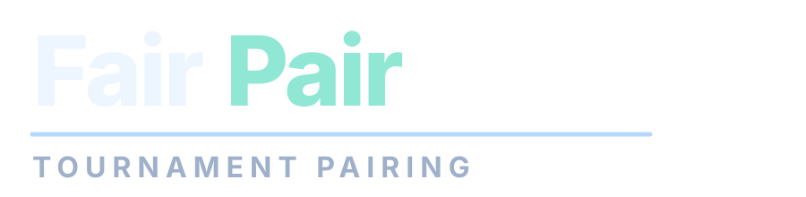

<p align="center">
  
</p>

# Fair Pair

**Fair Pair** is a lightweight vibe-coded browser app that helps a tournament organizer build the **next round pairings** with a visual interface.

The app does **not** compute match winners, points, or Swiss standings. The organizer remains the source of truth for scoring outside the app.

## Product scope

- Manage multiple tournaments locally.
- For each round, guide the organizer through **two explicit views**:
  1. **Pairing view:** assign players to tables (and optional BYE) by drag and drop.
  2. **Ranking view:** set the global ranking manually (with ties) by drag and drop.
- Keep pairing helper algorithms available, but always let the organizer override manually.

## Features

- **Tournament setup and root management:** create/open/delete tournaments from a home grid. Tournament setup only requires a name and the player list.
- **Manual-first pairing workflow:** before each round, the organizer fills every table slot manually by drag-and-drop from a player pool.
- **Touch-friendly drag and drop:** pairing and ranking drag-and-drop are designed to work on tablets (touch/pen) and desktop pointer devices.
- **Automatic pairing assistant (optional):** inside the pairing view, a dedicated panel lets the organizer choose:
  - mode: random or automatic,
  - BYE strategy: random eligible or lowest-ranked eligible,
  - priority order: any permutation of `avoid rematch`, `minimize ranking gap`, `bye fairness`.
  Pressing **Try** fills table slots automatically, but the organizer can still edit everything manually.
- **Round start gate:** a round can start only when every player is assigned exactly once across tables + optional BYE.
- **Manual ranking workflow:** after starting a round, the organizer sets global ranking as vertical ranks with ties (multiple players on the same rank row).
- **Ranking reset shortcut:** in ranking view, a dedicated reset action clears current ranking placements without leaving the round flow.
- **Reversible round navigation:** while a round draft is active, the organizer can go back from ranking to pairing without losing draft data, or return to tournament view (with confirmation to discard the draft).
- **Clear round context:** pairing and ranking screens prominently display the current round number and active step.
- **No score computation:** the app never stores points/wins/losses and never derives ranking from match results.
- **Automatic persistence:** complete app state is stored in `localStorage` after every change.
- **Centralized in-app notifications:** validation and success feedback use a non-blocking stacked notification UI.
- **Internationalization:** English and French are supported; default language follows browser language.

## Technology

- HTML5 + CSS3 + Vanilla JavaScript (native ES modules).
- Bootstrap 5 via CDN.
- `localStorage` persistence.
- No backend, no database, no build pipeline.

## Suggested structure

```text
fair-pair/
├── README.md
└── docs/
    ├── index.html             # Application shell
    ├── style.css              # Visual styles (dark modern UI)
    ├── app.js                 # Thin app entrypoint
    ├── app/
    │   ├── main.js            # App bootstrap + render orchestration
    │   ├── listeners.js       # UI listeners + drag-drop interactions
    │   ├── renderers.js       # Home/setup/tournament view rendering
    │   ├── constants.js       # i18n messages + UI constants
    │   └── utils.js           # Shared app utilities
    ├── pairing.js             # Pure pairing assistant logic
    └── tournament-state.js    # Pure app/tournament state helpers
```

## Running tests

```bash
npm test
```

Tests use Node built-in test runner and focus on:
- pairing assistant correctness and edge cases,
- compact scenario-matrix coverage for automatic pairing behaviors (priority order, rematches, odd-player BYE fairness),
- BYE fairness,
- state migration and tournament lifecycle helpers,
- ranking-group normalization rules.

## Technical requirements

1. **Exact matching for automatic mode:** automatic pairing uses exact minimum-cost perfect matching (bitmask DP), with configurable priority order.
2. **Manual control first:** automatic suggestions never lock the organizer; all pairings and rankings remain editable by drag and drop.
3. **Serializable state model:** all tournaments, rounds, pairing drafts, and ranking groups are persisted in one versioned localStorage payload.

## Deployment

The application is hosted at:

https://fabienrohrer.github.io/fair-pair/

Push files to GitHub and enable GitHub Pages from `/docs` on branch `main`.
